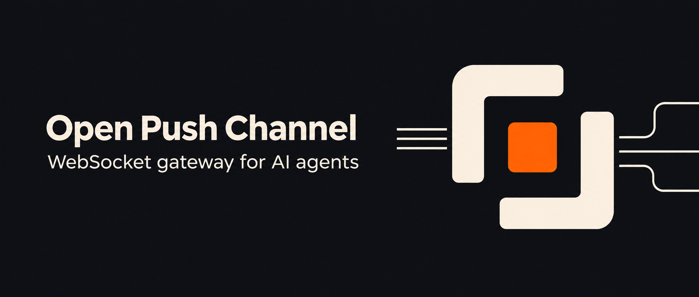

# Open Push Channel

[简体中文](README.md) · [English](README.en.md)



Open Push Channel is a self-hosted WebSocket gateway for connecting OpenClaw, DeepSeek Harness, and Pi to your existing web applications and business systems. Your frontend can stream replies, tool calls, and subagent updates. Your backend can start tasks or send notifications over HTTP.

For example, add an agent panel to a help desk. An operator asks a question from a ticket, and the panel streams the answer. When the ticket closes, the backend can ask the agent to write a summary or push an existing result to that conversation. After reconnecting and resubscribing, the client can replay stored events.

- **Reuse your application integration.** A shared event protocol covers streamed text, tools, subagents, and run status. The UI can show controls based on each runtime's advertised capabilities.
- **Use your existing agents.** Each runtime manages its models, tools, workspace, and native session history. A conversation binds to a runtime and an agent when it starts.
- **Deploy the gateway independently.** Run it with Node.js or build the [standalone gateway image](deploy/gateway/README.md). OpenClaw and native dsh plugins run in their respective hosts. A separate [runtime runner](deploy/runtime-runner/README.md) includes the executables for managed dsh and Pi RPC.

## Connect an existing application

| What you want to do | Interface | What happens |
| --- | --- | --- |
| Chat and show progress | WebSocket or the browser SDK | The page sends messages and receives events for its conversation. |
| Ask an agent to do work | `POST /api/tasks` | The gateway returns a run ID. Execution events arrive over WebSocket. |
| Deliver a result or notification | `POST /api/send` | The gateway delivers the notification to the target conversation and can replay it after reconnect. |
| Inspect the deployment | `GET /healthz`, `GET /api/runtimes` | Check whether the gateway responds and list configured runtimes. The catalog requires the server token when auth is enabled. |

Start the gateway and connect one runtime. Open the included Demo, start a conversation, and send a message. Once you see a reply, use the browser SDK in your own page and add HTTP calls from your backend as needed. Keep the server token in the backend. Give each browser only its authorized client token.

## Quick start

You need Node.js 22.19+ on the 22.x line or Node.js 24+, and a supported runtime with a working model configuration. For OpenClaw, use the compiled plugin archive from the [v0.1.0 release](https://github.com/xiehaojie/open-push-channel/releases/tag/v0.1.0), or build it with `npm ci` and `npm pack` in the project root.

From a terminal, clone the repository and configure the OpenClaw plugin:

```sh
git clone https://github.com/xiehaojie/open-push-channel.git
cd open-push-channel
npm ci
npm pack
openclaw plugins install "npm-pack:$PWD/open-push-channel-0.1.0.tgz"
openclaw plugins enable push-channel
openclaw config set channels.push-channel.enabled true
openclaw config set channels.push-channel.middlewareUrl http://127.0.0.1:3001
openclaw config set channels.push-channel.listenPort 3002
openclaw config set channels.push-channel.listenPath /webhook
```

If OpenClaw uses a plugin allowlist, add `push-channel`. The sample gateway configuration authorizes the OpenClaw agent `main`. To use a different agent, copy [the sample](admin-backend/gateway.quickstart.example.json) to `admin-backend/gateway.config.local.json`, change the target `agentId`, and pass the new filename to the start command.

Generate separate credentials for the browser, backend, and webhook, then start the gateway:

```sh
export PUSH_GATEWAY_CLIENT_TOKEN="$(openssl rand -hex 32)"
export PUSH_CHANNEL_PUSH_TOKEN="$(openssl rand -hex 32)"
export PUSH_CHANNEL_WEBHOOK_TOKEN="$(openssl rand -hex 32)"
npm --prefix admin-backend ci
npm --prefix admin-backend start -- --config gateway.quickstart.example.json
```

In a second terminal, provide the same `PUSH_CHANNEL_WEBHOOK_TOKEN` and `PUSH_CHANNEL_PUSH_TOKEN` to OpenClaw, then start or restart its Gateway. Open the [local Demo](http://127.0.0.1:3001/demo/) and connect to `http://127.0.0.1:3001` as client `demo` with the generated browser token. Start a conversation named `quickstart` with the OpenClaw agent `main` and send a message.

With the conversation open, send a notification from a terminal that holds the same push token:

```sh
curl --fail-with-body http://127.0.0.1:3001/api/send \
  -H "Authorization: Bearer $PUSH_CHANNEL_PUSH_TOKEN" \
  -H 'Content-Type: application/json' \
  -d '{"clientId":"demo","agentId":"main","sessionId":"quickstart","eventId":"quickstart-notice","content":"Push is connected."}'
```

Update the agent ID in the Demo and notification request if you changed the sample target. Reusing the same notification ID with the same payload deduplicates a retry. See the [integration guide](docs/integration.md) for a browser example, backend requests, and authentication setup for deployments beyond loopback.

## Runtime support

| Runtime | Connection | Selected capabilities |
| --- | --- | --- |
| OpenClaw | Host plugin over HTTP/SSE | Streaming, tools, and subagent events |
| DeepSeek Harness 0.2.1-rc.2 | Native plugin | Live streaming, tools, local subagent events, steering, and follow-up |
| DeepSeek Harness SDK | Gateway-managed JSON-RPC | Committed messages, tools, and subagent events |
| Pi Coding Agent 1.3.0 | Gateway-managed RPC | Streaming, tools, steering, follow-up, cancellation, and subagent events through the included extension |

See [runtime setup](docs/runtimes.md) for version and configuration details. One gateway process can handle multiple clients and conversations. Runs within the same conversation are processed in order. Use one gateway process per SQLite file.

[Protocol reference](docs/protocol.md) · [Contributing](CONTRIBUTING.md) · [Security](SECURITY.md) · [MIT license](LICENSE)
