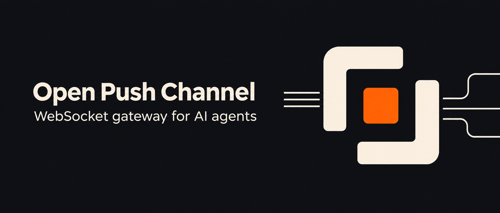

# Open Push Channel

[简体中文](README.zh-CN.md) · [English](../README.md)



独立部署的 WebSocket 消息网关，用同一套接口把 OpenClaw、DeepSeek Harness 和 Pi 接入自己的网页或业务系统。业务页面发消息并实时展示回复、工具和子智能体进度，业务后端可以触发任务或推送通知。

例如，给已有的工单页面加一个智能体面板。客服在工单里发送问题，页面通过 WebSocket 显示回复。工单状态变化后，后端可以让智能体补充摘要，或把已有结果推回原会话。用户离开页面后，已保存的事件可以在重新订阅时回放。

- **复用同一套前端代码。** 统一事件描述消息增量、工具调用和执行结果，页面根据底座实际能力显示操作。
- **使用自己的智能体配置。** OpenClaw、dsh 和 Pi 继续管理各自的模型、工具、工作空间、会话历史和编排。
- **从聊天扩展到业务事件。** 浏览器订阅会话，业务后端用 HTTP 接口启动任务或投递通知。

[业务系统接入](integration.md) · [底座配置](runtimes.md) · [协议参考](protocol.md) · [贡献指南](../CONTRIBUTING.md)

## 接入已有项目

| 你想做什么 | 调用方式 | 会得到什么 |
| --- | --- | --- |
| 在网页里与智能体聊天 | WebSocket 或浏览器 SDK | 实时回复、工具与子智能体事件 |
| 根据业务事件让智能体执行任务 | 后端 `POST /api/tasks` | 返回运行 ID。执行结果通过 WebSocket 到达原会话 |
| 把业务系统已有的结果推给用户 | 后端 `POST /api/send` | 通知送入指定会话。用户离线时可在重新订阅后收到 |
| 检查网关与已配置的底座 | `GET /healthz`、`GET /api/runtimes` | 网关存活状态、底座目录 |

1. **启动网关，连上一个底座。** 用下方快速开始验证第一条回复。已有 OpenClaw 可以使用现有模型和智能体。
2. **在业务页面建立会话。** 例如用工单 ID 作会话 ID，在浏览器中用客户端令牌连接网关。发送消息后，通过同一连接接收回复和进度。
3. **在业务后端调用 HTTP 接口。** 例如工单关闭后提交摘要任务，或将已有处理结果推送到工单会话。后端持有自己的服务端令牌。

[业务系统接入指南](integration.md)提供可以直接试用的网页和 HTTP 示例。

## 部署方式

网关可以用 Node.js 独立启动，或部署为[仅包含网关和 Demo 的容器](../deploy/gateway/README.md)。OpenClaw 和 dsh 原生插件运行在各自宿主中。需要把 dsh SDK、Pi RPC 与网关一起打包时，使用[运行容器](../deploy/runtime-runner/README.md)。

一个网关进程可服务多个客户端和会话，同一会话的运行按序处理。每个 SQLite 文件交给一个网关进程使用。使用和部署边界见[业务系统接入](integration.md#重连去重和部署边界)。

## 用 OpenClaw 发出第一条消息

准备 Node.js 22.19+（22.x）或 24+（推荐 Node.js 24），以及已配置模型、可以正常对话的 OpenClaw。插件包已在 OpenClaw 2026.5.28 和 2026.5.31 验证安装。最低插件 API 要求见 [package.json](../package.json) 中的 `openclaw.compat`。

克隆仓库，在项目根目录打包并安装 OpenClaw 插件。也可从 [Releases](https://github.com/xiehaojie/open-push-channel/releases) 下载同版本的插件包，跳过 `npm ci` 和 `npm pack`。

```bash
git clone https://github.com/xiehaojie/open-push-channel.git
cd open-push-channel
npm ci
npm pack
openclaw plugins install "npm-pack:$PWD/open-push-channel-0.1.0.tgz"
openclaw plugins enable push-channel
openclaw config set channels.push-channel.enabled true
openclaw config set channels.push-channel.middlewareUrl http://127.0.0.1:3001
openclaw config set channels.push-channel.listenPort 3002
openclaw config set channels.push-channel.listenPath /webhook
```

如果 OpenClaw 配置了插件允许列表，把 `push-channel` 加入现有列表。示例使用 `main` 智能体。如果你使用其他智能体，先复制[示例配置](../admin-backend/gateway.quickstart.example.json)为 `admin-backend/gateway.config.local.json`，修改 `targets` 中的 `agentId`，启动时传入对应文件名。

在项目根目录生成三个令牌，再启动消息网关。客户端令牌填进 Demo，推送令牌供业务后端和 OpenClaw 使用，Webhook 令牌保护网关到 OpenClaw 的连接。

```bash
export PUSH_GATEWAY_CLIENT_TOKEN="$(openssl rand -hex 32)"
export PUSH_CHANNEL_PUSH_TOKEN="$(openssl rand -hex 32)"
export PUSH_CHANNEL_WEBHOOK_TOKEN="$(openssl rand -hex 32)"
npm --prefix admin-backend ci
npm --prefix admin-backend start -- --config gateway.quickstart.example.json
```

另开终端，把同样的 `PUSH_CHANNEL_WEBHOOK_TOKEN` 和 `PUSH_CHANNEL_PUSH_TOKEN` 注入 OpenClaw 进程，然后启动或重启 OpenClaw Gateway 以加载插件。可用 `openclaw plugins info push-channel` 检查加载状态。

1. 打开 [本地 Demo](http://127.0.0.1:3001/demo/)。网关地址填 `http://127.0.0.1:3001`，客户端 ID 填 `demo`，网关令牌填刚生成的 `PUSH_GATEWAY_CLIENT_TOKEN` 值。
2. 点击「连接」，选择 OpenClaw，目标智能体填示例配置中的 `main`，新会话 ID 填 `quickstart`。
3. 点击「开始新会话」，发送「你好」，确认收到回复。

同机快速开始使用本机监听地址。网关绑定非本机地址时需要配置认证。对外提供服务时，按[认证配置](integration.md#为业务系统配置认证)设置身份，并按[部署说明](../deploy/gateway/README.md)保护底座端口。

可以再用一次主动推送验证后台通知。保留上面的会话，在持有同一个推送令牌的终端执行：

```bash
curl --fail-with-body http://127.0.0.1:3001/api/send \
  -H "Authorization: Bearer $PUSH_CHANNEL_PUSH_TOKEN" \
  -H 'Content-Type: application/json' \
  -d '{"clientId":"demo","agentId":"main","sessionId":"quickstart","eventId":"quickstart-notice","content":"主动推送已连接"}'
```

同一个 `eventId` 重发同样的内容只投递一次。要发新通知，请换一个 ID。

## 连接其他底座

| 底座 | 接入方式 | 聊天、工具、子智能体 | 引导与跟进 | 单次运行取消 |
| --- | --- | --- | --- | --- |
| OpenClaw | 宿主插件 + HTTP/SSE | 支持流式回复、工具和子智能体 | 未接入 | 未接入 |
| DeepSeek Harness 0.2.1-rc.2 | `open-push-channel/dsh` 原生插件 | 支持实时流、工具和本机进程内子智能体 | 支持 | 未接入 |
| DeepSeek Harness SDK | 网关托管 JSON-RPC | 支持已提交消息、工具和原生子智能体 | 未接入 | 未接入 |
| Pi Coding Agent 1.3.0 | 网关托管 RPC | 支持实时流和工具，随项目提供子智能体扩展 | 支持 | 支持 |

各底座都可以通过网关接收会话通知和外部任务。创建会话时选择底座与智能体，切换目标时新建会话。安装命令、宿主要求和工作空间配置见[底座配置](runtimes.md)。

## 遇到问题

| 现象 | 检查 |
| --- | --- |
| 打不开 Demo | 确认网关已启动，检查 `curl --fail http://127.0.0.1:3001/healthz` |
| 已连接，但 OpenClaw 未回复 | 检查插件加载状态、宿主模型和智能体 ID，以及插件监听端口 |
| 回复正常，但主动推送收不到 | 检查 OpenClaw 的 `middlewareUrl` 是否指向当前网关，以及客户端、会话和智能体 ID 是否匹配 |
| dsh 已出现在列表，但发消息报离线 | 检查 dsh 插件日志，核对连接地址、运行时 ID 和令牌 |
| 网关返回 401 | 按调用方向核对使用的是浏览器、后端、原生插件或 OpenClaw webhook 的令牌 |

`/healthz` 只检查网关进程。发送第一条真实消息，才能确认底座和模型链路。

## 开发和许可证

在 [CONTRIBUTING.md](../CONTRIBUTING.md) 查看模块分工和测试命令。部署容器见[运行容器](../deploy/runtime-runner/README.md)，安全问题请按 [SECURITY.md](../SECURITY.md) 报告。

项目使用 [MIT 许可证](../LICENSE)。
